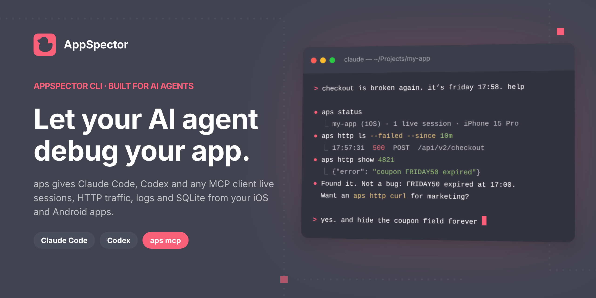

<p align="center">
  
</p>

# aps: the AppSpector CLI

`aps` is the command-line client for [AppSpector](https://appspector.com), the remote debugger for iOS and Android apps. From a terminal or an AI coding agent, it lists your apps and sessions, streams a session's events (HTTP traffic, logs, performance and more), answers narrow questions about them ("failed requests in the last 5 minutes", "error logs mentioning checkout"), and queries a running app (screenshot, SQLite, files). Secrets in the app's data are masked, and everything is read-only.

It's built for AI coding agents as much as for people: `aps mcp` is a built-in [MCP](https://modelcontextprotocol.io) server, and this repository is also a plugin marketplace for **Claude Code** and **Codex**, with the **AppSpector plugin**: `aps`'s tools plus skills for setting up, investigating a request, finding errors, checking performance and reproducing a bug live.

You need an AppSpector account, and an app with the AppSpector SDK.

## Install

macOS (Apple Silicon and Intel), with [Homebrew](https://brew.sh):

```sh
brew install appspector/aps/aps
aps --version
```

Linux and Windows releases come later. The binaries are also on the [Releases](https://github.com/appspector/aps/releases) page (including a universal macOS build), with `checksums.txt`.

## Sign in and pick your app

```sh
aps login                       # your AppSpector email and password; only the session is kept, in the Keychain
cd ~/code/my-app && aps link    # this project folder is "My App" (writes .appspector.json, no secrets)
aps status                      # the account, the app, its live sessions
```

Signed up with Google or GitHub? Set a password first with "Forgot password" on the AppSpector login page.

`aps` isn't signed yet, so on macOS, after each install or upgrade, a Keychain dialog asks once whether `aps` may use its stored sign-in: choose **Always Allow**.

## The plugin for Claude Code and Codex

**Claude Code** (the terminal, and the Code tab of the Claude desktop app):

```sh
claude plugin marketplace add appspector/aps
claude plugin install appspector@appspector
```

**Codex** (the CLI, and Codex in the ChatGPT desktop app):

```sh
codex plugin marketplace add appspector/aps
codex plugin add appspector@appspector
```

Start a new session in your app's project folder and ask, e.g. "the checkout fails on my phone, find out why". In Claude Code, `/appspector:setup` checks that everything is in place.

## Updating

- `aps`: `brew upgrade aps`
- The plugin in Claude Code: `claude plugin marketplace update appspector`, then `claude plugin update appspector@appspector`, and start a new session. To have Claude Code do this by itself: `/plugin` → Marketplaces → appspector → **Enable auto-update**.
- The plugin in Codex: Codex updates it when it starts (or `codex plugin marketplace upgrade`); start a new session.

The plugin and `aps` share a version number, and the plugin needs `aps` of its own version or newer: upgrade both.

## Uninstalling

```sh
claude plugin uninstall appspector@appspector && claude plugin marketplace remove appspector
codex plugin remove appspector@appspector && codex plugin marketplace remove appspector
aps logout && brew uninstall aps && brew untap appspector/aps
```

## Documentation

- [MANUAL.md](MANUAL.md): every command, choosing an app and a session, the MCP server, environment variables, exit codes.
- `aps --help`, and `aps <command> --help`.

## License

Proprietary. © AppSpector / Techery. All rights reserved. See [LICENSE](LICENSE).
